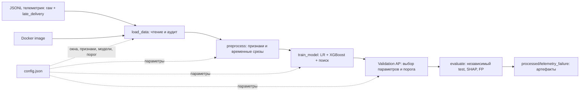

# Архитектура конвейера

## Слои, зависимости и хранение

| Слой | Компонент | Вход → выход | Хранение |
|---|---|---|---|
| Источник | JSONL по датам, включая опоздавшую доставку | Сырые события → аудит файлов и нормализованная таблица | `dataset/` на хосте; не включается в Git или Docker image |
| Конфигурация | `config.json` + CLI overrides | Окна, split, параметры моделей, бюджет тревог → эффективная конфигурация | Корень репозитория; копируется в контейнер |
| Загрузка | `load_data` и `telemetry_hw.load_telemetry/normalize` | JSONL → записи, профиль источника, rejected rows | Память; аудит JSON в `processed/telemetry_failure/` |
| Подготовка | `preprocess`, `build_snapshot` | История до cutoff и события будущего горизонта → признаки и метка | Parquet `node_time_dataset.parquet` |
| Обучение | `train_model` | Train → логистическая регрессия, базовая и настроенная XGBoost | Сохранённые joblib/UBJ модели |
| Выбор | Validation AP и политика тревог | Validation → гиперпараметры и фиксированный порог | `selection_frozen.json`, `validation_thresholds.csv` |
| Оценка | `evaluate` + диагностика/SHAP | Фиксированные модели и порог + test → метрики, прогнозы, объяснения | `evaluation.json`, Parquet, CSV, NPZ |
| Повторный запуск | Fingerprint входов, конфига и кода | Совпадающий fingerprint → повторное использование выходов | `run_manifest.json` |
| Контейнер | Dockerfile | Python + зависимости + код → тот же CLI | Данные/результаты подключаются bind mount-ами |

Поток направлен слева направо. Порог и гиперпараметры выбираются на validation до обращения к test. Если изменился входной файл, конфигурация или код, fingerprint меняется и обучение запускается заново. Флаг `--force` отключает повторное использование даже при совпавшем fingerprint.
